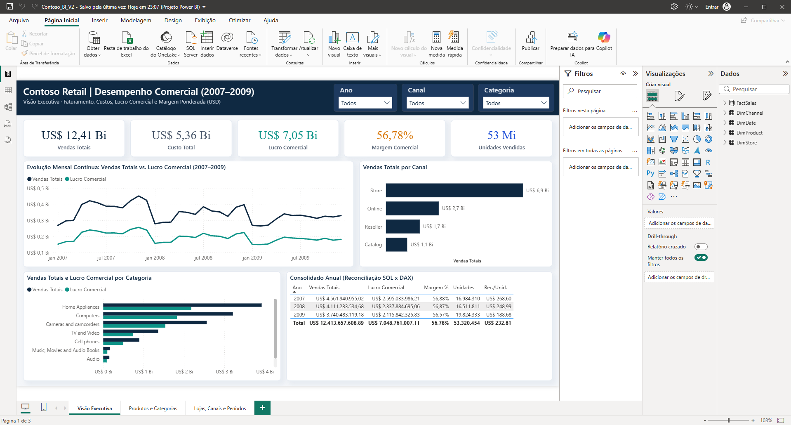
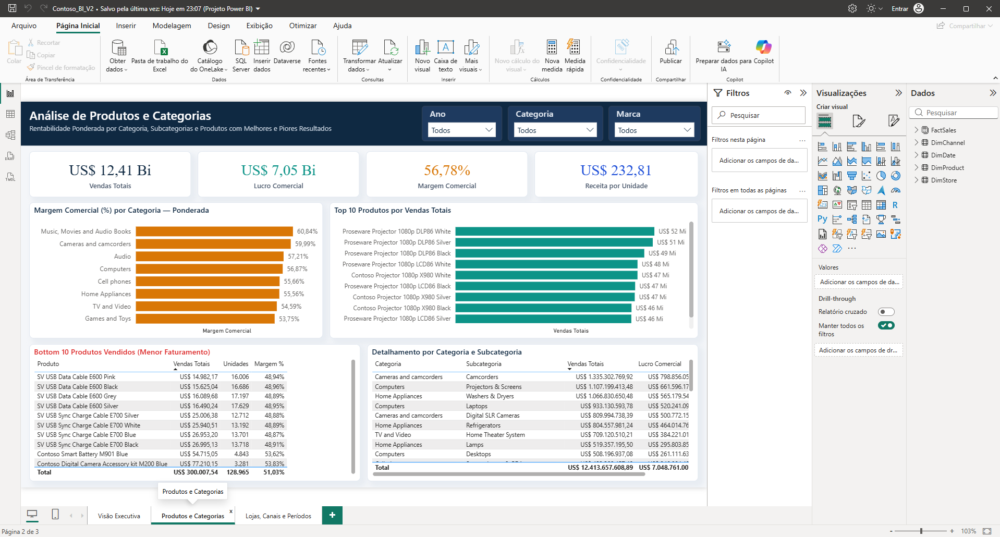
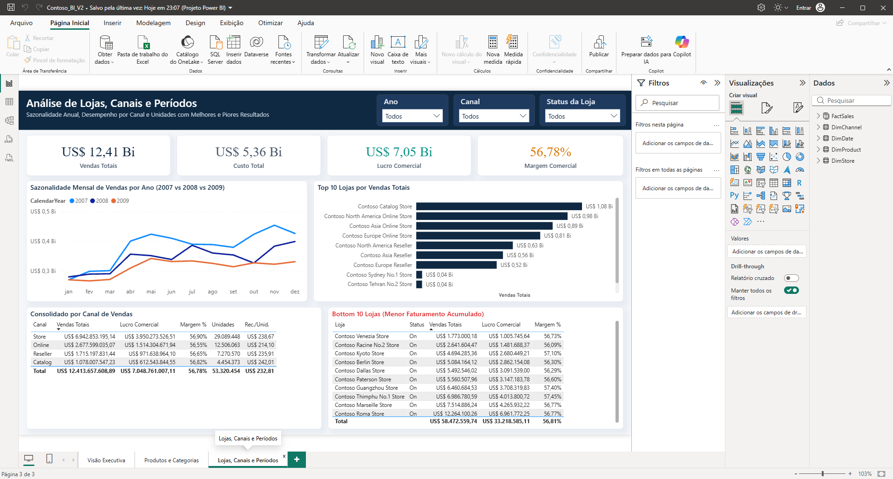
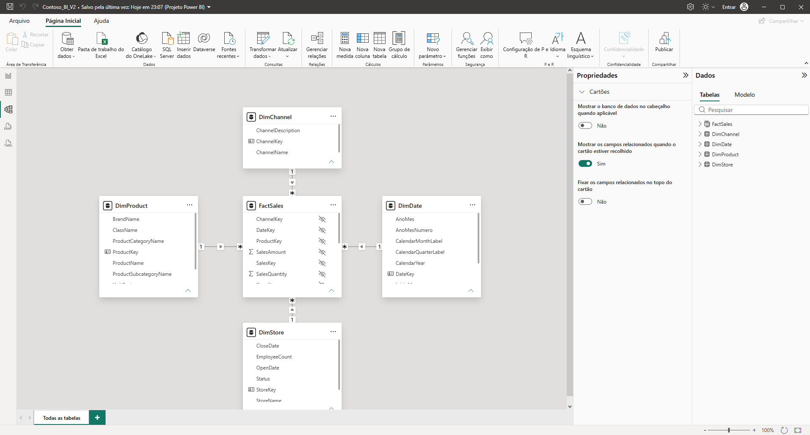
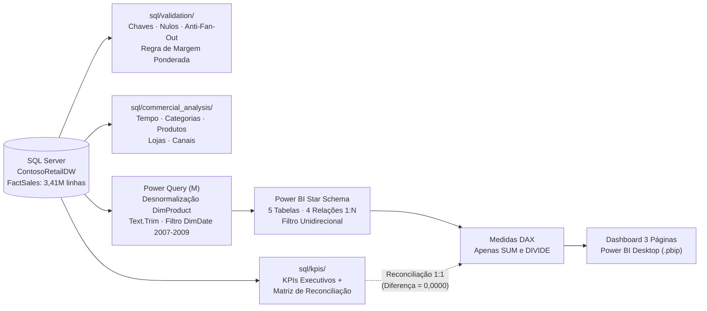
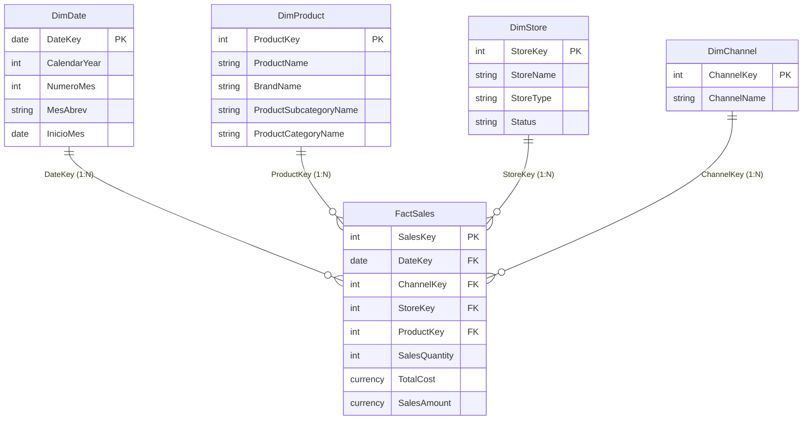

# Contoso Retail | Business Intelligence & SQL Commercial Analysis (V2)

Solução de análise de desempenho comercial e **Business Intelligence** construída sobre o banco relacional **ContosoRetailDW** (`SQL Server` + `Power BI Desktop`), combinando auditoria de qualidade de dados em T-SQL, modelagem dimensional em **Esquema Estrela**, medidas DAX validadas e um relatório executivo interativo de 3 páginas.

> **Aviso de escopo:** Este é um projeto **demonstrativo e educacional de portfólio**, desenvolvido em ambiente local sobre a base fictícia de varejo `ContosoRetailDW` da Microsoft. Ele **não** representa uma implantação em ambiente corporativo de produção.

---

## 1. Problema Empresarial e Objetivo

Em operações de varejo multicanal, olhar apenas o faturamento consolidado pode mascarar dinâmicas críticas de negócio. Entre **2007 e 2009**, a rede fictícia Contoso registrou queda contínua de receita (**USD 4,56 bi -> USD 3,74 bi**), mas em **2009** o volume de unidades vendidas saltou **+20,06%** (de `16,51 mi` para `19,82 mi`) enquanto a margem comercial permaneceu resiliente acima de **56,5%**.

**Objetivo do projeto:** Estruturar uma arquitetura analítica confiável, auditável e reproduzível que responda a perguntas comerciais essenciais sobre:
- Faturamento, custos comerciais, lucro comercial, margem comercial ponderada e unidades vendidas;
- Evolução anual (YoY), evolução mensal contínua (36 meses) e sazonalidade;
- Desempenho por produto, categoria, subcategoria, loja e canal de vendas;
- Identificação criteriosa dos melhores e piores resultados (produtos, subcategorias e lojas).

---

## 2. Capturas Reais do Dashboard (Power BI Desktop)

As imagens abaixo foram capturadas diretamente do relatório real construído e atualizado sobre o banco local `ContosoRetailDW` em [`powerbi/Contoso_BI_V2/Contoso_BI_V2.pbip`](powerbi/Contoso_BI_V2/Contoso_BI_V2.pbip).

### Página 1 · Visão Executiva

### Página 2 · Análise de Produtos e Categorias

### Página 3 · Análise de Lojas, Canais e Períodos

### Modelo Dimensional em Esquema Estrela (Exibição de Modelo)

---

## 3. Arquitetura da Solução

Documentação detalhada em [`docs/ARCHITECTURE.md`](docs/ARCHITECTURE.md) e [`docs/DATA_DICTIONARY.md`](docs/DATA_DICTIONARY.md).

---

## 4. Modelo de Dados (Esquema Estrela)

No banco original (`ContosoRetailDW`), a hierarquia de produtos é **snowflake** (`DimProduct -> DimProductSubcategory -> DimProductCategory`). No Power BI, essas tabelas foram **desnormalizadas no Power Query** (após auditoria comprovar cardinalidade exata 1:1 em 2.517 produtos) para formar um **Esquema Estrela puro** com 5 tabelas e 4 relacionamentos ativos `1:N` unidirecionais:

Detalhes completos de Power Query, limpeza de dados (`Text.Trim` em `'Cameras and camcorders '` e `'Smart phones & PDAs '`) e ordenação de datas em [`powerbi/model_documentation.md`](powerbi/model_documentation.md).

---

## 5. Tecnologias e Recursos Utilizados

| Camada | Tecnologia | Recursos Empregados |
| --- | --- | --- |
| **Banco Relacional** | SQL Server (`ContosoRetailDW`) | `SELECT`, `WHERE`, `DISTINCT`, `TOP`, `ORDER BY`, `COUNT`, `SUM`, `AVG`, `GROUP BY`, `HAVING`, `INNER JOIN`, `LEFT JOIN`, `COUNT(DISTINCT)`, `IN`, `NOT IN`, `BETWEEN`, `IS NULL`, `YEAR`, `MONTH`, `CASE WHEN`, CTEs, subconsultas, `ROW_NUMBER() OVER (PARTITION BY ...)`, `CAST`, `NULLIF` |
| **ETL / Tratamento** | Power Query (M) | Importação SQL Server, seleção de colunas, tipagem explícita, mesclagem de dimensões (Snowflake -> Estrela), `Text.Trim`, filtro temporal (`2007–2009`), colunas auxiliares de ordenação |
| **Modelagem & BI** | Power BI Desktop (`.pbip`) | Esquema Estrela (5 tabelas), relacionamentos `1:N` unidirecionais, medidas DAX com `SUM` e `DIVIDE`, cartões, segmentadores, filtros Top N / Bottom N |
| **Versionamento** | Git / GitHub | Preservação integral da `main` (V1) e evolução isolada em `feature/business-intelligence-v2` |

---

## 6. Indicadores (Medidas DAX)

Todas as medidas estão documentadas em [`powerbi/measures.dax`](powerbi/measures.dax) e utilizam exclusivamente `SUM`, subtração entre medidas e `DIVIDE`:

| Indicador | Fórmula DAX | Regra de Negócio |
| --- | --- | --- |
| **Vendas Totais** | `SUM(FactSales[SalesAmount])` | Receita comercial faturada, líquida de descontos (`USD`). |
| **Custo Total** | `SUM(FactSales[TotalCost])` | Custo comercial total registrado na `FactSales` (`USD`). |
| **Unidades Vendidas** | `SUM(FactSales[SalesQuantity])` | Volume total de itens comercializados. |
| **Lucro Comercial** | `[Vendas Totais] - [Custo Total]` | Margem bruta comercial sobre vendas faturadas (`USD`). |
| **Margem Comercial** | `DIVIDE([Lucro Comercial], [Vendas Totais])` | **Margem ponderada correta** (razão de totais, com proteção contra divisão por zero). |
| **Receita por Unidade** | `DIVIDE([Vendas Totais], [Unidades Vendidas])` | Indicador unitário de apoio para análise de mix e preço médio realizado. |

> **Por que não usar média simples das margens?** A auditoria em [`sql/validation/03_validacao_calculos_financeiros.sql`](sql/validation/03_validacao_calculos_financeiros.sql) comprovou que a média simples por linha gera **53,31%** (erro de **-3,47 p.p.**) e por produto gera **54,24%** (erro de **-2,54 p.p.**), frente à margem comercial ponderada real de **56,78%**.

---

## 7. Principais Consultas SQL

### 7.1 Camada V2 — Validação, KPIs e Análise Comercial

| Camada | Script | Pergunta Empresarial / Responsabilidade |
| --- | --- | --- |
| **Validação** | [01 · Integridade de chaves e nulos](sql/validation/01_integridade_chaves_duplicidade.sql) | Chaves primárias, granularidade composta da `FactSales`, auditoria de nulos e cobertura temporal. |
| **Validação** | [02 · Cardinalidade e anti-fan-out](sql/validation/02_cardinalidade_joins_granularidade.sql) | Chaves órfãs, desnormalização 1:1 da `DimProduct` e prova de diferença zero antes vs. após JOINs. |
| **Validação** | [03 · Validação de cálculos financeiros](sql/validation/03_validacao_calculos_financeiros.sql) | Sanidade de sinais, fórmula de `SalesAmount`/`TotalCost` e prova da margem ponderada vs. média simples. |
| **KPIs** | [01 · KPIs executivos gerais](sql/kpis/01_kpis_executivos_gerais.sql) | Painel consolidado (2007–2009) e evolução anual de todos os indicadores. |
| **KPIs** | [02 · Matriz de reconciliação Power BI](sql/kpis/02_matriz_reconciliacao_powerbi.sql) | 6 recortes independentes (total, ano, canal, categoria, 2D e 3D) para batimento SQL vs. DAX. |
| **Comercial** | [01 · Evolução anual e mensal](sql/commercial_analysis/01_evolucao_anual_e_mensal.sql) | Variação YoY (CTE + `LEFT JOIN`), série mensal completa (36 meses) e sazonalidade. |
| **Comercial** | [02 · Categorias e subcategorias](sql/commercial_analysis/02_desempenho_categorias_e_subcategorias.sql) | Participação de receita/lucro por categoria, faixas de margem (`CASE WHEN`) e Top/Bottom subcategorias. |
| **Comercial** | [03 · Melhores e piores produtos](sql/commercial_analysis/03_desempenho_produtos_melhores_e_piores.sql) | Top 10 e Bottom 10 produtos vendidos, Top 3 por categoria (`ROW_NUMBER` + `PARTITION BY`) e item sem venda. |
| **Comercial** | [04 · Melhores e piores lojas](sql/commercial_analysis/04_desempenho_lojas_melhores_e_piores.sql) | Top 10 / Bottom 10 geral com meses ativos, Top 10 lojas físicas (`Store`) e Top 3 por canal. |
| **Comercial** | [05 · Canais e mix comercial](sql/commercial_analysis/05_desempenho_canais_e_mix_comercial.sql) | Desempenho consolidado por canal, evolução canal × ano e investigação da dinâmica volume × preço em 2009. |

### 7.2 Exercícios Originais V1 (Preservados Integralmente)

Os 10 scripts originais escritos pessoalmente na V1 permanecem intactos na raiz de `sql/` (`01_analise_anual.sql` a `10_produtos_acima_media.sql`), acompanhados de suas 3 capturas originais do SSMS em `screenshots/` (`01_desempenho_canais.png`, `02_faixa_precos.png` e `03_produtos_acima_media.png`).

---

## 8. Resultados Verificados (SQL Server = Power BI DAX)

Todos os números abaixo foram executados sobre o banco local `ContosoRetailDW` e reconciliados com **0,0000 de divergência** contra o motor Tabular do Power BI Desktop (ver relatório completo em [`reports/sql_dax_validation_report.md`](reports/sql_dax_validation_report.md)):

### 8.1 KPIs Consolidados e Evolução Anual

| Período | Vendas Totais (USD) | Custo Total (USD) | Lucro Comercial (USD) | Margem Comercial | Unidades Vendidas | Receita / Unid. (USD) |
| --- | ---: | ---: | ---: | ---: | ---: | ---: |
| **2007** | 4.561.940.955,02 | 1.966.906.968,81 | 2.595.033.986,21 | 56,88% | 16.984.310 | 268,60 |
| **2008** | 4.111.233.534,68 | 1.773.348.839,62 | 2.337.884.695,06 | 56,87% | 16.511.811 | 248,99 |
| **2009** | 3.740.483.119,18 | 1.624.640.793,35 | 2.115.842.325,83 | 56,57% | 19.824.333 | 188,68 |
| **Total (2007–2009)** | **12.413.657.608,89** | **5.364.896.601,78** | **7.048.761.007,11** | **56,78%** | **53.320.454** | **232,81** |

### 8.2 Principais Achados Comerciais

- **Dinâmica Volume × Preço em 2009:** As unidades vendidas saltaram **+20,06%** em 2009, mas o faturamento recuou **-9,02%** devido à queda de **-24,22%** na receita média por unidade (`USD 248,99 -> USD 188,68`), puxada pelo forte crescimento de volume em `Cell phones` (`5,77 mi` un. a `USD 47,39`/un.) e `Games and Toys` (`2,46 mi` un. a `USD 26,59`/un.), além de menor ticket unitário em `Home Appliances` e `Cameras and camcorders`.
- **Concentração por Categorias:** As 3 maiores categorias — **Home Appliances** (`USD 3,92 bi`, 31,60%), **Computers** (`USD 3,21 bi`, 25,85%) e **Cameras and camcorders** (`USD 2,56 bi`, 20,64%) — respondem por **78,09%** da receita total. **Music, Movies and Audio Books** tem a maior margem (**60,84%**), enquanto **Games and Toys** registra a menor (**53,75%**).
- **Desempenho por Canal:** **Store** lidera o faturamento total (**55,93%** distribuídos em `299` lojas), mas **Online** foi o **único canal com crescimento anual contínuo** (`USD 789,38 mi -> USD 937,07 mi -> USD 951,15 mi`), quase dobrando o volume de unidades entre 2007 e 2009.
- **Melhores e Piores Produtos:** Projetores 1080p da categoria `Computers` ocupam 9 das 10 primeiras posições (líder: `Proseware Projector 1080p DLP86 White`, `USD 51,90 mi`, margem `66,71%`). Na ponta inferior dos itens vendidos estão cabos USB (`SV USB Data Cable E600 Pink`, `USD 14.982,17` em `16.006` un.), além de `1` produto de catálogo sem vendas na `FactSales` (`ProductKey = 944`).
- **Melhores e Piores Lojas:** As 7 maiores unidades individuais são canais centralizados (`Contoso Catalog Store`, `USD 1,08 bi`). Entre lojas físicas (`Store`), lidera `Contoso Sydney No.1 Store` (`USD 37,93 mi`). Na ponta inferior acumulada aparece `Contoso Venezia Store` (`USD 1,77 mi` em 12 meses ativos, média `USD 147,75 mil/mês`); já `Contoso Kyoto Store` (3ª menor no acumulado) operou em apenas 8 meses, com média de `USD 586,79 mil/mês` — reforçando a importância de avaliar maturidade operacional.

---

## 9. Como Reproduzir o Projeto

### Pré-requisitos
- SQL Server (2019/2022/2025) + SSMS ou `sqlcmd`
- Base relacional **ContosoRetailDW** restaurada localmente ([download oficial da Microsoft](https://www.microsoft.com/en-us/download/details.aspx?id=18279)); o dataset não é redistribuído neste repositório. Para preencher o PBIP, é necessário ter o SQL Server ativo, restaurar a base e atualizar o modelo. A abertura do projeto foi verificada; a atualização dos dados não foi repetida nesta publicação porque o serviço local estava parado.
- Power BI Desktop (versão recente com suporte a projetos `.pbip`)

### Passo a Passo
1. **Restaure `ContosoRetailDW`** na instância `localhost` do SQL Server.
2. **Execute a auditoria SQL** em `sql/validation/` (01 -> 03) para validar integridade da base local.
3. **Execute os KPIs e análises comerciais** em `sql/kpis/` e `sql/commercial_analysis/` (qualquer ordem, apenas leitura).
4. **Abra o relatório no Power BI Desktop:**
   - Acesse **Arquivo -> Abrir relatório** e selecione [`powerbi/Contoso_BI_V2/Contoso_BI_V2.pbip`](powerbi/Contoso_BI_V2/Contoso_BI_V2.pbip).
   - Clique em **Atualizar** na faixa **Página Inicial** para importar os dados do seu SQL Server local.
   - Confira os 6 cenários de controle de [`sql/kpis/02_matriz_reconciliacao_powerbi.sql`](sql/kpis/02_matriz_reconciliacao_powerbi.sql) nos filtros do dashboard.

---

## 10. Limitações Conhecidas

1. **Dados demonstrativos:** `ContosoRetailDW` é uma base sintética (2007–2009), com pequenas peculiaridades cadastrais documentadas em [`docs/DATA_DICTIONARY.md`](docs/DATA_DICTIONARY.md) (ex.: lojas com `OpenDate` em meados de 2009 possuindo vendas distribuídas em 12 meses).
2. **Escopo financeiro:** `Lucro Comercial = SalesAmount - TotalCost` representa margem bruta comercial sobre vendas faturadas (líquidas de desconto). Não contempla estornos financeiros de devoluções (`ReturnAmount`), tributos ou despesas operacionais (aluguel, folha, logística).
3. **Tabela fato única na V2:** O modelo estrela analisa `dbo.FactSales` (100% em `USD`). Transações individuais de clientes em `dbo.FactOnlineSales` permanecem cobertas na consulta original V1 (`sql/09_top_clientes_online.sql`).
4. **Projeto fora de produção:** Construído localmente para portfólio, aprendizado estruturado e demonstração técnica.

---

## 11. Material de Aprendizagem e Documentação

- [`docs/ARCHITECTURE.md`](docs/ARCHITECTURE.md) — Arquitetura ponta a ponta e decisões técnicas
- [`docs/DATA_DICTIONARY.md`](docs/DATA_DICTIONARY.md) — Dicionário de dados, fórmulas e achados de qualidade
- [`powerbi/model_documentation.md`](powerbi/model_documentation.md) e [`powerbi/dashboard_specification.md`](powerbi/dashboard_specification.md) — Documentação completa do modelo e das 3 páginas visuais
- [`reports/sql_dax_validation_report.md`](reports/sql_dax_validation_report.md) — Reconciliação completa SQL vs. DAX

---

## 12. Minha Contribuição e Assistência de IA

- **Minha contribuição:** Desenvolvi originalmente no SSMS as 10 consultas comerciais da V1 (`sql/01..10_*.sql`), conduzi a exploração prática do banco `ContosoRetailDW`, defini os objetivos empresariais e restringi explicitamente a evolução V2 ao conjunto de recursos SQL Server e Power BI compatíveis com meu domínio atual.
- **Assistência de IA:** Utilizei um assistente de IA como mentor técnico na evolução V2 para estruturar a arquitetura modular do repositório, escrever scripts de auditoria e reconciliação, estruturar o projeto Power BI (`.pbip`), validar a equivalência SQL vs. DAX e produzir guias de estudo, desafios práticos e preparação para entrevistas — com todos os resultados executados e verificados sobre o banco real e o Power BI Desktop local.

---

## Autor

**Luan Gabriel** · Estudante de Inteligência Artificial e Machine Learning na UNIASSELVI · [GitHub](https://github.com/LuanGabriel12)
