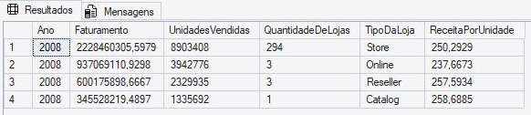
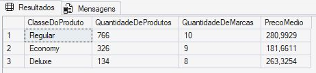
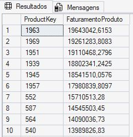

# Contoso Retail | SQL Server Sales Analysis

Em 2008, qual canal de varejo gerou mais receita? E qual loja, considerada individualmente, ficou em primeiro lugar? Na base de demonstração da Contoso, as lojas do tipo **Store** lideraram em conjunto, enquanto a **Contoso North America Online Store** foi a unidade de maior faturamento. A resposta muda conforme a unidade de análise.

Este projeto reúne dez consultas em T-SQL que escrevi durante uma prática de análise comercial no SQL Server Management Studio (SSMS), com o apoio de um tutor de IA. O objetivo foi partir de perguntas de varejo e escolher, para cada uma, a tabela, o período e o agrupamento adequados.

## Visualização dos Resultados

### Faturamento e receita por unidade em cada canal

Qual tipo de loja faturou mais em 2008? E qual obteve mais receita por unidade vendida?



**Store** liderou em faturamento, com **USD 2,23 bilhões** distribuídos por **294 lojas**. Ao dividir a receita pelas unidades vendidas, **Catalog** ficou à frente, com **USD 258,69 por unidade**. [Ver a consulta de desempenho dos canais](sql/05_desempenho_canais.sql).

### Variedade de produtos por classe

Entre os produtos com preço de catálogo de 100 a 500, qual classe oferece o maior sortimento?



A classe **Regular** reuniu **766 produtos de 10 marcas**. Nessa faixa, seu sortimento foi maior que o de **Economy** (326 produtos) e **Deluxe** (134) somadas. [Ver a consulta por faixa de preço](sql/07_analise_faixa_precos.sql).

### Produtos que superaram o faturamento médio

Depois de somar as vendas de cada produto em 2008, quais deles ultrapassaram a média desses totais?



Dos **2.244 produtos** com registros no ano, **724** superaram a média de **USD 1.832.100,51**. A captura mostra os dez primeiros. O produto de código **1963** liderou com **USD 19,64 milhões**. [Ver a consulta com a subconsulta de média](sql/10_produtos_acima_media.sql).

## Perguntas de negócio

A evolução mensal ajuda a localizar mudanças no volume vendido. O ranking de produtos mostra quais itens mais contribuem para o faturamento. Para investigar devoluções, a medida é outra: a quantidade de unidades devolvidas. Cada consulta abaixo pode ser executada separadamente.

| Análise e script | Pergunta respondida | Principais recursos SQL |
| --- | --- | --- |
| [01 · Vendas por ano](sql/01_analise_anual.sql) | Quanto a rede faturou, quantas unidades vendeu e qual foi a diferença entre faturamento e custo em cada ano? | `YEAR`, `SUM`, subtração, `GROUP BY` |
| [02 · Evolução mensal](sql/02_vendas_mensais.sql) | Como o faturamento e as unidades vendidas variaram ao longo dos 12 meses de 2008? | `WHERE`, `MONTH`, `SUM`, ordenação cronológica |
| [03 · Top 10 produtos](sql/03_top_produtos.sql) | Quais produtos geraram mais receita em todo o período registrado na `FactSales`? | `INNER JOIN`, `SUM`, `TOP (10)` |
| [04 · Ranking das lojas](sql/04_ranking_lojas.sql) | Quais cinco unidades comerciais mais faturaram em 2008? | `INNER JOIN`, intervalo de datas, `TOP (5)` |
| [05 · Desempenho dos canais](sql/05_desempenho_canais.sql) | Quanto cada tipo de loja faturou em 2008, com quantas lojas, quantas unidades vendidas e qual receita por unidade? | `GROUP BY`, `COUNT(DISTINCT)`, divisão de somas |
| [06 · Devoluções por produto](sql/06_analise_devolucoes.sql) | Entre os produtos com mais de 290 unidades devolvidas no período completo, quais tiveram os maiores volumes de devolução? | `INNER JOIN`, `HAVING`, `TOP (10)` |
| [07 · Sortimento por classe](sql/07_analise_faixa_precos.sql) | Na faixa de preço de 100 a 500, inclusive, quantos produtos e marcas há em cada classe e qual é o preço médio de catálogo? | `BETWEEN`, `COUNT(DISTINCT)`, `AVG` |
| [08 · Produtos sem vendas registradas](sql/08_produtos_sem_vendas.sql) | Quais produtos do catálogo não têm nenhuma linha correspondente na `FactSales`? | `LEFT JOIN`, `IS NULL` |
| [09 · Maiores clientes online](sql/09_top_clientes_online.sql) | Quais foram os dez clientes de maior faturamento online em 2008 e quantos pedidos distintos fizeram? | `INNER JOIN`, `TOP (10)`, `COUNT(DISTINCT)` |
| [10 · Produtos acima da média](sql/10_produtos_acima_media.sql) | Quais produtos faturaram mais que a média dos totais por produto em 2008? | `SUM`, subconsulta, `AVG`, `HAVING` |

## Resultados verificados

Executei as dez consultas sobre uma cópia local do **ContosoRetailDW** em SQL Server 2025. Os valores de venda em `FactSales` e nas vendas online de 2008 estão associados à moeda **USD** na dimensão `DimCurrency`. Os valores monetários abaixo foram arredondados para apresentação.

| Recorte | Resultado |
| --- | --- |
| Lojas e canais em 2008 · 04 e 05 | O tipo **Store** somou **USD 2,23 bilhões** em 294 lojas. Entre as unidades individuais, a **Contoso North America Online Store** liderou com **USD 348,41 milhões**. |
| Devoluções · 06 | O **Contoso Multi-Use Terminal Cable E308 Silver** registrou **310 unidades devolvidas**. O ranking mede volume absoluto. Para comparar a frequência relativa de devoluções, seria preciso considerar também o volume vendido. |
| Faixa de preço · 07 | A classe **Regular** reuniu **766 produtos de 10 marcas** com preço unitário de catálogo entre 100 e 500. Cada produto entra uma vez no cálculo do preço médio. |
| Cobertura do catálogo · 08 | Apenas a **A. Datum Compact Digital Camera M200 Black** (`ProductKey = 944`) apareceu sem correspondência na `FactSales`. A consulta cobre exclusivamente essa tabela. Para avaliar vendas online, é preciso consultar a `FactOnlineSales` separadamente. |
| Clientes online em 2008 · 09 | A **BerlinCompany4** liderou com **USD 19.030.477,99** e **247 pedidos distintos**. O agrupamento usa a chave do cliente, e a contagem usa o número do pedido para evitar contar suas linhas como compras diferentes. |
| Faturamento por produto em 2008 · 10 | Entre **2.244 produtos** com registro na `FactSales` naquele ano, a média dos totais foi **USD 1.832.100,51**. **724 produtos** ficaram estritamente acima dela. |

## Base de dados e critérios

O **ContosoRetailDW** é um banco relacional fictício de varejo distribuído pela Microsoft. Os nomes comerciais e resultados deste estudo pertencem ao cenário demonstrativo. [Fonte oficial e download da base](https://www.microsoft.com/en-us/download/details.aspx?id=18279).

| Origem | Relacionamento ou uso |
| --- | --- |
| `FactSales` | Fornece data, faturamento, unidades, custo e devoluções. Liga-se a `DimProduct` por `ProductKey` e a `DimStore` por `StoreKey`. |
| `DimProduct` | Identifica nome, marca, classe e preço de catálogo. Na análise 08, o catálogo fica à esquerda do `LEFT JOIN` para preservar os produtos sem correspondência. |
| `DimStore` | Identifica cada unidade e seu tipo. A análise 05 agrupa por `StoreType`. Nos registros de 2008, os tipos Store, Online, Reseller e Catalog coincidiram com os nomes da `DimChannel` ao conferir a chave de canal. |
| `FactOnlineSales` e `DimCustomer` | A análise 09 usa as vendas online e relaciona cada registro ao cliente por `CustomerKey`. O nome da empresa e o tipo de cliente ajudam a identificar compradores corporativos. |

O **lucro bruto estimado** da análise 01 é `SUM(SalesAmount) - SUM(TotalCost)`. A consulta considera o custo registrado nas vendas e não apura despesas operacionais, impostos ou lucro líquido. Na análise 05, a **receita por unidade** divide o faturamento total pela quantidade total vendida de cada tipo de loja.

## Como executar

1. Obtenha o pacote relacional **ContosoBIdemoBAK.exe** e extraia o arquivo `ContosoRetailDW.bak`. [Download da Microsoft](https://www.microsoft.com/en-us/download/details.aspx?id=18279).
2. No SSMS, conecte-se ao **Mecanismo de Banco de Dados** da sua instância SQL Server. Se já tiver o `ContosoRetailDW` restaurado, siga para o próximo passo. Para uma instalação nova, use **Bancos de Dados → Restaurar Banco de Dados → Dispositivo**, selecione o backup e restaure-o em um destino livre. A instância precisa ser compatível com a versão do backup. [Guia de restauração da Microsoft](https://learn.microsoft.com/pt-br/sql/relational-databases/backup-restore/restore-a-database-backup-using-ssms).
3. Abra um dos arquivos da pasta `sql/` no SSMS e selecione **ContosoRetailDW** na lista de bancos da janela de consulta.
4. Pressione **F5** para executar o arquivo inteiro. Todos contêm apenas consultas de leitura e podem ser abertos em qualquer ordem.

As consultas esperam o esquema `dbo` da edição relacional, com `DateKey` do tipo data/hora. Outras edições da Contoso podem usar tabelas diferentes, datas codificadas como inteiros ou outro conjunto de registros. Nesses casos, confira o esquema e o período antes de comparar resultados.

<details>
<summary>Estrutura do repositório</summary>

```text
contoso-retail-sql-analysis/
├── README.md
├── .gitignore
├── screenshots/
│   ├── 01_desempenho_canais.png
│   ├── 02_faixa_precos.png
│   └── 03_produtos_acima_media.png
└── sql/
    ├── 01_analise_anual.sql
    ├── 02_vendas_mensais.sql
    ├── 03_top_produtos.sql
    ├── 04_ranking_lojas.sql
    ├── 05_desempenho_canais.sql
    ├── 06_analise_devolucoes.sql
    ├── 07_analise_faixa_precos.sql
    ├── 08_produtos_sem_vendas.sql
    ├── 09_top_clientes_online.sql
    └── 10_produtos_acima_media.sql
```

</details>

## Aprendizados

Contar clientes, pedidos e unidades exige escolher o que cada linha representa. No exercício 09, por exemplo, identificar a empresa ajudou a interpretar o ranking, e contar números de pedido distintos permitiu medir quantas compras cada cliente fez.

Ainda estou aprendendo subconsultas. No exercício 10, tive bastante ajuda do tutor de IA para montar a solução. Primeiro somamos o faturamento de cada produto no ano. Depois calculamos a média desses totais e usamos esse valor no `HAVING`. Calcular a média diretamente sobre cada linha de venda responderia a outra pergunta.

## Autor

**Luan Gabriel** · Estudante de Inteligência Artificial e Machine Learning na UNIASSELVI. [Perfil no GitHub](https://github.com/LuanGabriel12).
