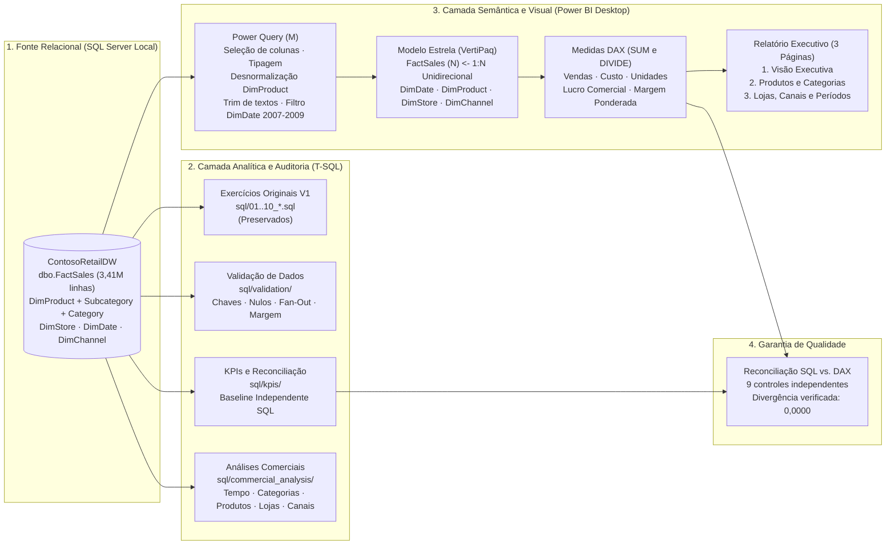

# Arquitetura da Solução — Contoso Business Intelligence V2

Este documento apresenta a arquitetura técnica, o fluxo de dados, a organização das camadas SQL e Power BI e as decisões de engenharia adotadas na evolução do projeto **Contoso Business Intelligence V2** (`branch: feature/business-intelligence-v2`).

> **Escopo demonstrativo:** Este é um projeto de portfólio educacional e demonstrativo construído sobre a base fictícia `ContosoRetailDW` da Microsoft em ambiente local. Não representa um sistema implantado em produção corporativa.

---

## 1. Visão Geral da Arquitetura (Fluxo Ponta a Ponta)



---

## 2. Princípios Arquiteturais Adotados

1. **Preservação Integral da V1:** Os dez scripts originais (`sql/01_analise_anual.sql` a `sql/10_produtos_acima_media.sql`), as três capturas do SSMS (`screenshots/`) e o histórico Git da `main` permanecem intactos. Toda a evolução V2 ocorre na branch `feature/business-intelligence-v2`.
2. **Aderência Estrita ao Nível Técnico:** Todos os scripts SQL e medidas DAX utilizam exclusivamente recursos dominados e documentados pelo autor — sem complexidade artificial (`LAG`, `CALCULATE`, Time Intelligence avançada ou bibliotecas Python de análise/gráficos).
3. **Separação por Responsabilidade (SQL Modular):**
   - `sql/validation/`: garante confiabilidade antes de responder perguntas de negócio (chaves primárias, granularidade, nulos, órfãos, anti-fan-out e regra da margem ponderada).
   - `sql/kpis/`: consolida indicadores executivos e gera a matriz independente de batimento com o Power BI.
   - `sql/commercial_analysis/`: responde perguntas comerciais específicas (evolução temporal, categorias/subcategorias, melhores/piores produtos, melhores/piores lojas e desempenho por canal).
4. **Esquema Estrela Puro no Power BI:**
   - Transformação da hierarquia snowflake de produtos (`DimProduct` -> `DimProductSubcategory` -> `DimProductCategory`) em uma única dimensão `DimProduct` plana no Power Query, com cardinalidade 1:1 comprovada.
   - Quatro relacionamentos ativos `1:N` unidirecionais (`Dimensões -> FactSales`), evitando filtros bidirecionais e ambiguidades.
5. **Reconciliação Independente:** Nenhum número do dashboard é aceito sem confronto com consultas T-SQL independentes executadas diretamente sobre o `ContosoRetailDW`.

---

## 3. Estrutura do Repositório V2

```text
contoso-retail-sql-analysis/
├── README.md                                  # Apresentação profissional V2 para recrutadores
├── .gitignore                                 # Regras de exclusão (backups, temporários, credenciais)
├── screenshots/                               # Capturas originais da V1 no SSMS (preservadas)
│   ├── 01_desempenho_canais.png
│   ├── 02_faixa_precos.png
│   └── 03_produtos_acima_media.png
├── sql/
│   ├── 01_analise_anual.sql ... 10_*.sql      # 10 exercícios originais V1 (preservados sem alteração)
│   ├── validation/                            # Auditoria de chaves, granularidade, JOINs e cálculos
│   │   ├── 01_integridade_chaves_duplicidade.sql
│   │   ├── 02_cardinalidade_joins_granularidade.sql
│   │   └── 03_validacao_calculos_financeiros.sql
│   ├── kpis/                                  # KPIs consolidados e matriz de batimento Power BI
│   │   ├── 01_kpis_executivos_gerais.sql
│   │   └── 02_matriz_reconciliacao_powerbi.sql
│   └── commercial_analysis/                   # Análises comerciais por dimensão de negócio
│       ├── 01_evolucao_anual_e_mensal.sql
│       ├── 02_desempenho_categorias_e_subcategorias.sql
│       ├── 03_desempenho_produtos_melhores_e_piores.sql
│       ├── 04_desempenho_lojas_melhores_e_piores.sql
│       └── 05_desempenho_canais_e_mix_comercial.sql
├── powerbi/
│   ├── Contoso_BI_V2/                         # Projeto Power BI (.pbip) real e versionável em Git
│   │   ├── Contoso_BI_V2.pbip
│   │   ├── Contoso_BI_V2.SemanticModel/       # model.bim (Power Query M + Estrela + DAX) e diagramLayout.json
│   │   └── Contoso_BI_V2.Report/              # report.json (3 páginas executivas)
│   ├── measures.dax                           # Medidas DAX documentadas (SUM e DIVIDE)
│   ├── model_documentation.md                 # Documentação do modelo estrela e Power Query
│   └── dashboard_specification.md             # Especificação visual, identidade e guia de reconstrução
├── reports/
│   ├── sql_dax_validation_report.md           # Relatório completo de reconciliação SQL vs. DAX
│   └── *.png                                  # Capturas reais do relatório e do modelo no Power BI Desktop
└── docs/
    ├── ARCHITECTURE.md                        # Este documento
    ├── DATA_DICTIONARY.md                     # Dicionário de dados, fórmulas e achados de qualidade
```

---

## 4. Decisão de Versionamento Power BI: Projeto `.pbip` em Texto Limpo

Em vez de versionar um arquivo `.pbix` binário pesado (~50+ MB com os 3,4 milhões de linhas em cache) no repositório Git, o projeto real foi entregue no formato oficial **Power BI Project (`.pbip`)** em `powerbi/Contoso_BI_V2/`:

- **Vantagens técnicas:** diff legível em Git, tamanho reduzido (< 100 KB), auditoria transparente das transformações Power Query (M), medidas DAX e visuais, além de abertura nativa em 1 clique no Power BI Desktop (`Arquivo -> Abrir -> Contoso_BI_V2.pbip`) seguida de **Atualizar** para carregar os dados do SQL Server local.
- **Compatibilidade verificada:** Aberto, atualizado integralmente sobre o `ContosoRetailDW` local (3.406.089 linhas) e verificado visualmente e via motor Tabular (`msmdsrv.exe`) no **Power BI Desktop 2.159**.

---

## 5. Decisões Técnicas Críticas e Trade-offs

| Decisão | Alternativa Descartada | Justificativa |
| --- | --- | --- |
| Desnormalizar `DimProduct` no Power Query | Manter 3 tabelas snowflake no modelo Power BI | Simplifica o grafo de filtros, reduz saltos de relacionamento e mantém um esquema estrela puro com 5 tabelas. |
| Filtrar `DimDate` para 2007–2009 no Power Query | Importar 2005–2011 completos | Elimina anos vazios nos filtros do dashboard preservando 100% das datas com vendas na `FactSales` (1.096 dias). |
| Calcular YoY no SQL com `CTE + LEFT JOIN` | Usar função `LAG()` | Mantém aderência total aos recursos SQL dominados pelo autor sem perda de precisão ou clareza. |
| Calcular `% Participação` no SQL com subconsulta escalar sobre CTE | Usar `SUM() OVER ()` | Evita introduzir recursos de janela fora da lista dominada, mantendo legibilidade e desempenho imediato sobre 4 a 8 grupos agregados. |
| Calcular Margem Comercial via `DIVIDE([Lucro Comercial], [Vendas Totais])` | Coluna calculada de margem + `AVERAGE` | Elimina distorção de `-3,47 p.p.` causada por média simples não ponderada pelo faturamento. |
| Ocultar colunas brutas da `FactSales` no Power BI | Permitir arrastar `SalesAmount` direto para visuais | Impõe uso exclusivo de medidas explícitas padronizadas e evita agregações implícitas inconsistentes. |
