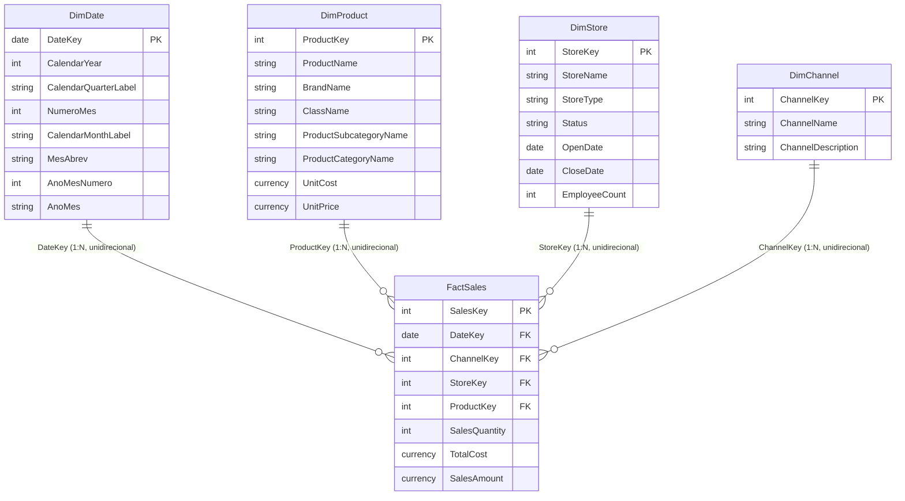

# Documentação do Modelo de Dados — Power BI (Contoso BI V2)

Este documento detalha o modelo semântico em **Esquema Estrela (Star Schema)** implementado no Power BI Desktop sobre o banco relacional **ContosoRetailDW** (`SQL Server`), mantendo aderência estrita aos recursos dominados no projeto: importação via SQL Server, tratamento no Power Query, tabelas fato e dimensões, relacionamentos `1:N` unidirecionais e medidas DAX com `SUM` e `DIVIDE`.

---

## 1. Diagrama do Modelo Estrela (Star Schema)

---

## 2. Tabelas e Decisões de Engenharia no Power Query

### 2.1 `FactSales` (Tabela Fato — 3.406.089 linhas)
- **Origem:** `dbo.FactSales` no banco `ContosoRetailDW` (`localhost`).
- **Granularidade:** 1 linha por combinação única de data, canal, loja, produto, promoção e moeda (validada com `0` duplicatas em `sql/validation/01_integridade_chaves_duplicidade.sql`).
- **Tratamento no Power Query:**
  1. Seleção apenas das 8 colunas necessárias (`SalesKey`, `DateKey`, `channelKey`, `StoreKey`, `ProductKey`, `SalesQuantity`, `TotalCost`, `SalesAmount`) — reduz consumo de memória no motor VertiPaq ao descartar colunas técnicas de ETL (`ETLLoadID`, `LoadDate`, `UpdateDate`) e colunas não usadas nos KPIs principais.
  2. Padronização do nome `channelKey` -> `ChannelKey`.
  3. Conversão explícita de `DateKey` para o tipo `date` (removendo horário `00:00:00` para garantir correspondência limpa com `DimDate[DateKey]`), `TotalCost` e `SalesAmount` para `Currency.Type` (Número Decimal Fixo).
- **Boas práticas na camada de relatório:** Todas as colunas numéricas brutas e chaves estrangeiras da `FactSales` são ocultadas na exibição de relatório para forçar o uso das medidas DAX explícitas (`Vendas Totais`, `Custo Total`, `Unidades Vendidas`, `Lucro Comercial`, `Margem Comercial`).

### 2.2 `DimProduct` (Dimensão Produto Desnormalizada — 2.517 linhas)
- **Problema no banco original:** No `ContosoRetailDW`, a hierarquia de produtos é **snowflake** (`DimProduct` -> `DimProductSubcategory` -> `DimProductCategory`).
- **Decisão arquitetural (Estrela Pura):** Em vez de criar uma cadeia de 3 tabelas dimensionais encadeadas no Power BI, mesclamos `DimProduct`, `DimProductSubcategory` e `DimProductCategory` diretamente no **Power Query** (`Mesclar Consultas` / `JoinKind.LeftOuter` + `Expandir Colunas`).
- **Validação da desnormalização:** `sql/validation/02_cardinalidade_joins_granularidade.sql` comprovou cardinalidade **1:1 exata** (`2.517` produtos antes e depois da mesclagem, `0` produtos sem subcategoria ou categoria).
- **Limpeza de dados aplicada (`Text.Trim`):** Remove espaços em branco residuais identificados na auditoria real da base, especificamente `'Cameras and camcorders '` e `'Smart phones & PDAs '`.

### 2.3 `DimStore` (Dimensão Loja — 306 linhas)
- **Origem:** `dbo.DimStore`.
- **Tratamento no Power Query:** Seleção das colunas analíticas (`StoreKey`, `StoreName`, `StoreType`, `Status`, `OpenDate`, `CloseDate`, `EmployeeCount`), `Text.Trim` nos campos textuais e tipagem de datas (`type date`).
- **Atenção analítica:** Inclui as **294 lojas ativas (`On`)** e as **12 lojas encerradas (`Off`)**, pois estas possuem `USD 272,58 milhões` de histórico válido na `FactSales`. O campo `Status` fica disponível como segmentador para o usuário analisar a rede total ou somente unidades ativas.

### 2.4 `DimDate` (Dimensão Calendário — 1.096 linhas no modelo)
- **Origem:** `dbo.DimDate`.
- **Tratamento no Power Query:**
  1. Renomeação `Datekey` -> `DateKey` (tipo `date`) e `CalendarMonth` -> `AnoMesNumero` (`YYYYMM`).
  2. Filtro temporal `CalendarYear >= 2007 and CalendarYear <= 2009`, alinhando o calendário aos 3 anos completos com vendas na `FactSales` e eliminando anos vazios (`2005`, `2006`, `2010`, `2011`) dos segmentadores.
  3. Criação de `NumeroMes` (`Date.Month([DateKey])`, valores `1..12`), `MesAbrev` (`jan`..`dez`) e `AnoMes` (`yyyy-MM`).
- **Configurações no Modelo:**
  - Tabela marcada como **Tabela de Datas** (`DateKey`).
  - `CalendarMonthLabel` e `MesAbrev` configuradas com **Classificar por Coluna** = `NumeroMes` (evita ordenação alfabética e corrige a armadilha de `CalendarMonth` original no formato `YYYYMM`).
  - `AnoMes` configurada com **Classificar por Coluna** = `AnoMesNumero`.

### 2.5 `DimChannel` (Dimensão Canal — 4 linhas)
- **Origem:** `dbo.DimChannel`.
- **Valores:** `1 = Store`, `2 = Online`, `3 = Catalog`, `4 = Reseller`.
- **Decisão arquitetural:** Mesmo havendo equivalência 1:1 com `DimStore[StoreType]` na `FactSales`, manter `DimChannel` dedicada separa o conceito de **canal de venda** dos atributos cadastrais da loja e segue o padrão oficial de Data Warehouse.

---

## 3. Matriz de Relacionamentos

| Origem (Lado N — Fato) | Coluna Origem | Destino (Lado 1 — Dimensão) | Coluna Destino | Cardinalidade | Direção do Filtro | Ativo? |
| --- | --- | --- | --- | --- | --- | --- |
| `FactSales` | `DateKey` | `DimDate` | `DateKey` | Muitos para Um (`*:1`) | Única (`DimDate -> FactSales`) | Sim |
| `FactSales` | `ProductKey` | `DimProduct` | `ProductKey` | Muitos para Um (`*:1`) | Única (`DimProduct -> FactSales`) | Sim |
| `FactSales` | `StoreKey` | `DimStore` | `StoreKey` | Muitos para Um (`*:1`) | Única (`DimStore -> FactSales`) | Sim |
| `FactSales` | `ChannelKey` | `DimChannel` | `ChannelKey` | Muitos para Um (`*:1`) | Única (`DimChannel -> FactSales`) | Sim |

**Por que nunca usar filtro bidirecional aqui?**
- Evita ambiguidade no grafo de propagação de filtros entre dimensões.
- Preserva desempenho ótimo no motor VertiPaq sobre os 3,4 milhões de linhas da `FactSales`.
- Garante comportamento previsível: qualquer filtro aplicado em `DimDate`, `DimProduct`, `DimStore` ou `DimChannel` filtra exclusivamente a `FactSales`.

---

## 4. Medidas DAX Implementadas

Todas as medidas residem na pasta de exibição `01. KPIs Principais` e `02. Indicadores Unitários` da `FactSales` (ver arquivo completo [`powerbi/measures.dax`](measures.dax)):

| Medida | Fórmula DAX | Formato | Justificativa Técnica |
| --- | --- | --- | --- |
| `Vendas Totais` | `SUM(FactSales[SalesAmount])` | `"US$" #,0.00` | Soma direta da receita faturada líquida de descontos. |
| `Custo Total` | `SUM(FactSales[TotalCost])` | `"US$" #,0.00` | Soma direta do custo comercial registrado. |
| `Unidades Vendidas` | `SUM(FactSales[SalesQuantity])` | `#,0` | Soma direta do volume de itens vendidos. |
| `Lucro Comercial` | `[Vendas Totais] - [Custo Total]` | `"US$" #,0.00` | Reaproveita medidas base garantindo consistência em qualquer contexto de filtro. |
| `Margem Comercial` | `DIVIDE([Lucro Comercial], [Vendas Totais])` | `0.00%` | **Margem ponderada correta** com proteção nativa contra divisão por zero. |
| `Receita por Unidade` | `DIVIDE([Vendas Totais], [Unidades Vendidas])` | `"US$" #,0.00` | Explica a variação de ticket médio por unidade entre anos, canais e categorias. |
| `Custo por Unidade` | `DIVIDE([Custo Total], [Unidades Vendidas])` | `"US$" #,0.00` | Custo unitário realizado ponderado pelo volume. |
| `Lucro por Unidade` | `DIVIDE([Lucro Comercial], [Unidades Vendidas])` | `"US$" #,0.00` | Lucro unitário realizado ponderado pelo volume. |

---

## 5. Código Power Query (M) Consolidado para Reconstrução Manual

Caso o aluno deseje recriar o modelo passo a passo do zero no Power BI Desktop (em vez de abrir o projeto pronto [`powerbi/Contoso_BI_V2/Contoso_BI_V2.pbip`](Contoso_BI_V2/Contoso_BI_V2.pbip)), os scripts M completos de cada tabela estão versionados em [`powerbi/Contoso_BI_V2/Contoso_BI_V2.SemanticModel/model.bim`](Contoso_BI_V2/Contoso_BI_V2.SemanticModel/model.bim) e seguem exatamente a sequência:

1. **Obter Dados -> SQL Server** (`Servidor: localhost`, `Banco de dados: ContosoRetailDW`, modo **Importar**).
2. Selecionar `dbo.FactSales`, `dbo.DimProduct`, `dbo.DimProductSubcategory`, `dbo.DimProductCategory`, `dbo.DimStore`, `dbo.DimDate` e `dbo.DimChannel`.
3. No Editor do Power Query:
   - Mesclar `DimProduct` -> `DimProductSubcategory` (`ProductSubcategoryKey`, Externa Esquerda) -> `DimProductCategory` (`ProductCategoryKey`, Externa Esquerda); expandir nomes; aplicar **Transformar -> Formato -> Cortar (`Text.Trim`)**; desabilitar carga de `DimProductSubcategory` e `DimProductCategory`.
   - Em `DimDate`, filtrar `CalendarYear` entre `2007` e `2009`; adicionar colunas `NumeroMes`, `MesAbrev` e `AnoMes`.
   - Em `FactSales`, manter apenas as 8 colunas analíticas, renomear `channelKey` para `ChannelKey` e converter `DateKey` para **Data** e valores monetários para **Número Decimal Fixo**.
4. **Fechar e Aplicar**, conferir os 4 relacionamentos `1:N` unidirecionais no **Modo de Exibição de Modelo**, configurar **Classificar por Coluna** na `DimDate` e criar as medidas de [`powerbi/measures.dax`](measures.dax).

---

## 6. Validação SQL vs. DAX

Todas as medidas acima foram validadas diretamente no motor Tabular do Power BI Desktop (`msmdsrv.exe`) após carga real do banco local `ContosoRetailDW`, com **0,0000 de divergência** nos 9 cenários independentes documentados em [`reports/sql_dax_validation_report.md`](../reports/sql_dax_validation_report.md).
